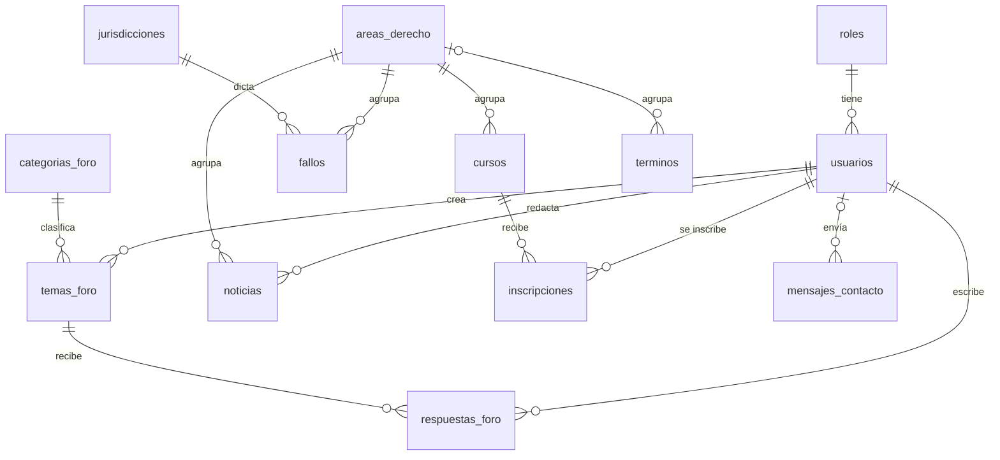

# TP N.º 6 – Normalización (Herme Iuris)

Proyecto: **Herme Iuris**, sitio educativo de derecho en PHP.
Base de datos: `hermeiuris` (MySQL, InnoDB, utf8mb4).

## 1. Entidad sin normalizar

Registro hipotético de lo que pasaría si guardáramos en una sola tabla a los usuarios con sus cursos (módulo *Cursos* + *Mi Cuenta*):

**Tabla `USUARIO_CURSOS` (sin normalizar)**

| email | nombre | rol | descripcion_rol | cursos_inscriptos | areas_cursos | fechas_inscripcion |
|---|---|---|---|---|---|---|
| lucia@mail.com | Lucía Pérez | estudiante | Accede a cursos y foro | Introducción al Derecho Civil; Derecho Laboral Básico | Civil; Laboral | 2026-03-01; 2026-04-10 |
| marcos@mail.com | Marcos Díaz | estudiante | Accede a cursos y foro | Derecho Laboral Básico | Laboral | 2026-04-12 |
| ana@mail.com | Ana Gómez | admin | Gestiona contenidos y usuarios | *(ninguno)* | | |

Problemas: campos multivalorados (`cursos_inscriptos`, `areas_cursos`, `fechas_inscripcion` guardan listas separadas por `;`), la descripción del rol se repite en cada fila y el área de un curso se repite por cada inscripto (anomalías de inserción, actualización y borrado).

## 2. Proceso de normalización

### Primera Forma Normal (1FN)
Se eliminan las listas: cada celda guarda un solo valor y hay una fila por cada combinación usuario–curso.

**`USUARIO_CURSOS` (1FN)** – PK compuesta: `(email, curso)`

| email | nombre | rol | descripcion_rol | curso | area_curso | fecha_inscripcion |
|---|---|---|---|---|---|---|
| lucia@mail.com | Lucía Pérez | estudiante | Accede a cursos y foro | Introducción al Derecho Civil | Civil | 2026-03-01 |
| lucia@mail.com | Lucía Pérez | estudiante | Accede a cursos y foro | Derecho Laboral Básico | Laboral | 2026-04-10 |
| marcos@mail.com | Marcos Díaz | estudiante | Accede a cursos y foro | Derecho Laboral Básico | Laboral | 2026-04-12 |
| ana@mail.com | Ana Gómez | admin | Gestiona contenidos y usuarios | NULL | NULL | NULL |

(Los usuarios sin cursos, como Ana, siguen apareciendo con valores nulos: otra señal de que falta separar entidades.)

### Segunda Forma Normal (2FN)
Con PK `(email, curso)` se analizan las dependencias:

- `nombre`, `rol`, `descripcion_rol` dependen **solo de `email`** → dependencia parcial.
- `area_curso` depende **solo de `curso`** → dependencia parcial.
- `fecha_inscripcion` depende de **ambos** (cuándo se inscribió ese usuario a ese curso) → queda en la tabla de relación.

Se descompone en tres tablas:

- `usuarios(email PK, nombre, rol, descripcion_rol)`
- `cursos(curso PK, area_curso)`
- `inscripciones(email FK, curso FK, fecha_inscripcion)` – PK `(email, curso)`

### Tercera Forma Normal (3FN)
Se eliminan las dependencias transitivas:

- En `usuarios`: `email → rol → descripcion_rol`. La descripción depende del rol, no del usuario → se extrae `roles(id_rol PK, nombre, descripcion)` y `usuarios` guarda solo `id_rol` (FK).
- En `cursos`: `curso → area_curso`, y el área tiene sus propios datos (descripción, imagen, ya usada en la Home y en noticias/fallos) → se extrae `areas_derecho(id_area PK, nombre, descripcion, imagen_url)` y `cursos` guarda `id_area` (FK).
- Se reemplazan las claves naturales (email, nombre del curso) por claves sustitutas `INT AUTO_INCREMENT`; el email queda como `UNIQUE`.

El mismo criterio se aplicó al resto de los módulos del sitio:

- **Foro:** `temas_foro` y `respuestas_foro` referencian a `usuarios` y a `categorias_foro` (la categoría no se repite como texto en cada tema).
- **Actualidad:** `noticias` referencia al autor (`usuarios`) y al `areas_derecho`.
- **Jurisprudencia:** `fallos` referencia a `jurisdicciones` (ámbito nacional/provincial + nombre) y a `areas_derecho`, en lugar de repetir el tribunal/ámbito en texto.
- **Glosario:** `terminos`, con área opcional.
- **Contacto:** `mensajes_contacto`, con usuario opcional (el formulario de `clase5/contacto.php` también lo usan visitantes sin cuenta).

## 3. Listado de tablas resultante

| Tabla | PK | FK |
|---|---|---|
| `roles` | `id_rol` | – |
| `usuarios` | `id_usuario` | `id_rol` → `roles` |
| `areas_derecho` | `id_area` | – |
| `categorias_foro` | `id_categoria` | – |
| `jurisdicciones` | `id_jurisdiccion` | – |
| `temas_foro` | `id_tema` | `id_usuario` → `usuarios`, `id_categoria` → `categorias_foro` |
| `respuestas_foro` | `id_respuesta` | `id_tema` → `temas_foro`, `id_usuario` → `usuarios` |
| `noticias` | `id_noticia` | `id_usuario` → `usuarios`, `id_area` → `areas_derecho` |
| `fallos` | `id_fallo` | `id_jurisdiccion` → `jurisdicciones`, `id_area` → `areas_derecho` |
| `terminos` | `id_termino` | `id_area` → `areas_derecho` (opcional) |
| `cursos` | `id_curso` | `id_area` → `areas_derecho` |
| `inscripciones` (N:M usuarios–cursos) | `id_inscripcion` (+ `UNIQUE(id_usuario, id_curso)`) | `id_usuario` → `usuarios`, `id_curso` → `cursos` |
| `mensajes_contacto` | `id_mensaje` | `id_usuario` → `usuarios` (opcional) |

### Diagrama entidad-relación

## Archivos de la entrega

- `schema.sql`: creación de la base, tablas, claves, auditoría e índices.
- `consultas.sql`: pruebas CRUD (INSERT, SELECT con WHERE/ORDER BY, INNER JOIN, UPDATE, DELETE).